# Lumen OS

**Español** · [English](README.en.md)

**Un Inicio estilo Apple TV para televisores Android TV / Google TV**: limpio, rápido y sin anuncios, con recomendaciones de tus propias apps, el clima y una animación de arranque propia. Se instala desde una computadora en la misma red Wi‑Fi. No hace root, no flashea nada y no desinstala nada; todo se puede deshacer con un solo comando.

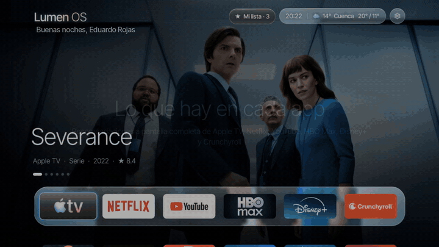

▶️ **[Ver el video completo (1:48)](docs/video/lumen-os-demo.mp4)**: arranque, recomendaciones de cada app, ficha con tráiler, Mi lista, clima y salvapantallas, grabado en un TV real.

📺 **[Tutorial de instalación en YouTube (2:33)](https://youtu.be/p3jJC1I-lsw)**: paso a paso con Windows, desde activar el modo desarrollador hasta verlo en el TV.

**Idiomas:** la interfaz usa el idioma de tu TV, **español** o **inglés**, y los títulos y sinopsis también.

## Qué trae

- **Recomendaciones a pantalla completa, como el "Top Shelf" de Apple TV.** Al pasar por cada app del dock aparece una película o serie de esa app (tendencias y estrenos en tu país), con título, tipo, año, puntuación y la etiqueta **Nuevo**. Cada vez que vuelves a una app sale otro título; si te quedas encima, cambian solas cada 12 s. Las listas se renuevan cada 3 horas.
  - Netflix, Disney+, HBO Max, Apple TV, Prime Video, Crunchyroll, Paramount+, MUBI, Pluto TV y Tubi, vía [TMDB](https://www.themoviedb.org/).
  - **YouTube**: los videos en tendencia de tu país, vía YouTube Data API.
  - Las apps de la cuadrícula (Prime Video, Pluto TV…) también muestran sus recomendaciones al pasar por ellas.
  - Una app sin catálogo muestra un degradado con su propio color.
- **Ficha con tráiler y Mi lista**: mantén OK (o pulsa Menú) sobre una app para ver la sinopsis, el reparto, el tráiler y guardar el título en **Mi lista**.
- **Destacados** (opcional): elige tus series favoritas para que salgan primero en cada app y en el salvapantallas.
- **Vidrio esmerilado** (estilo Liquid Glass): el dock y las píldoras dejan ver la imagen de fondo desenfocada, con brillo y borde de luz. Funciona en Android 11 sin desenfoque en vivo, así que no pesa.
- **Hora y clima** en una sola píldora (Open‑Meteo, sin clave). Pulsa OK para ver el clima **hora por hora**. Tu ciudad se detecta sola o la eliges al compilar. En Estados Unidos, en °F.
- **Saludo** con tu nombre ("Buenas noches, Ana") y **modo noche** automático después del atardecer.
- **Salvapantallas Lumen**: las imágenes de tus apps a pantalla completa, con hora, fecha y clima.
- **Se adapta a tu TV**: de 32 a 100 pulgadas, la interfaz se ajusta al tamaño de la pantalla.
- **Animación de arranque "Lumen OS"**: rayo de luz, el nombre letra por letra con un brillo dorado y la frase "Your cinema at home", con su propio sonido. Ver [`docs/arranque-preview.html`](docs/arranque-preview.html).
- **Dock de 6 apps** con todas tus demás apps debajo.
- **Botones del control** (Netflix, YouTube, engranaje) siguen funcionando sin el Inicio de Google.
- **Limpieza reversible** de anuncios, telemetría y demos del fabricante (perfil probado para TCL G07).
- **Monitor en vivo** (Windows): cada comando con su hora y el logcat del TV mientras se ejecuta.

## Capturas

| Arranque | Inicio con Apple TV |
|---|---|
| 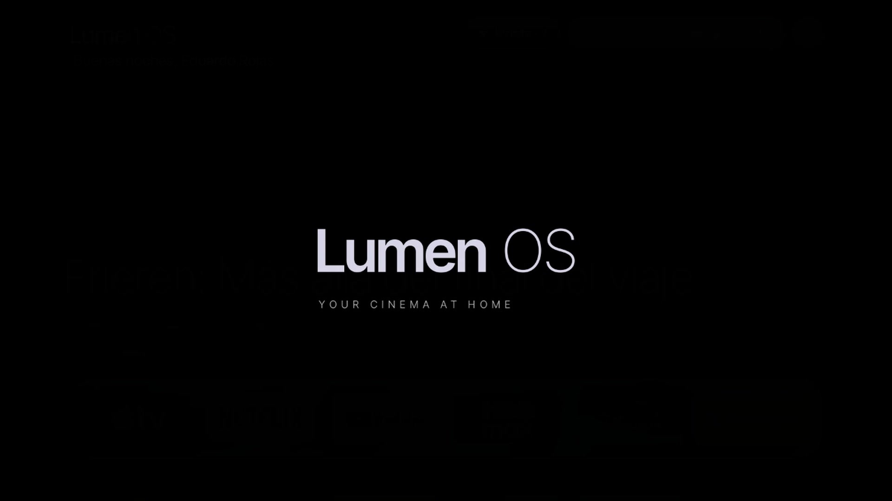 | 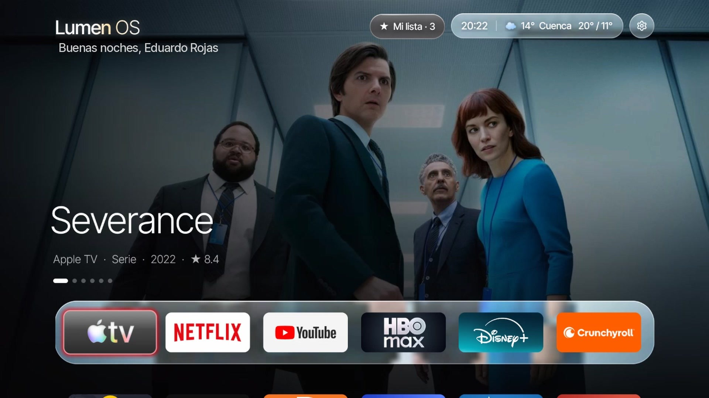 |
| **Netflix** | **YouTube en tendencia** |
| 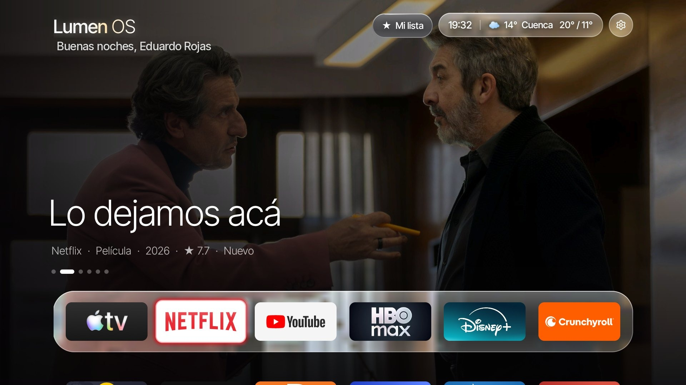 | 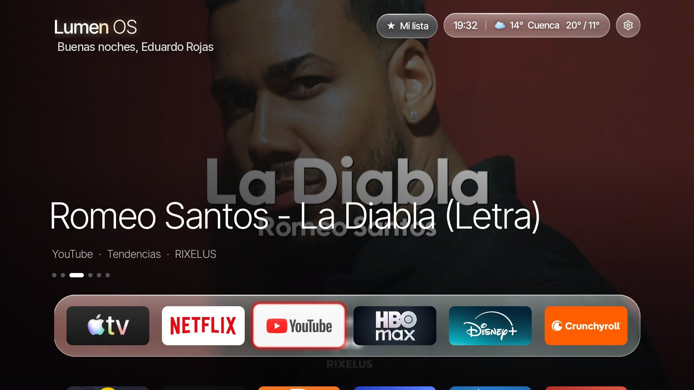 |
| **HBO Max** | **Disney+** |
| 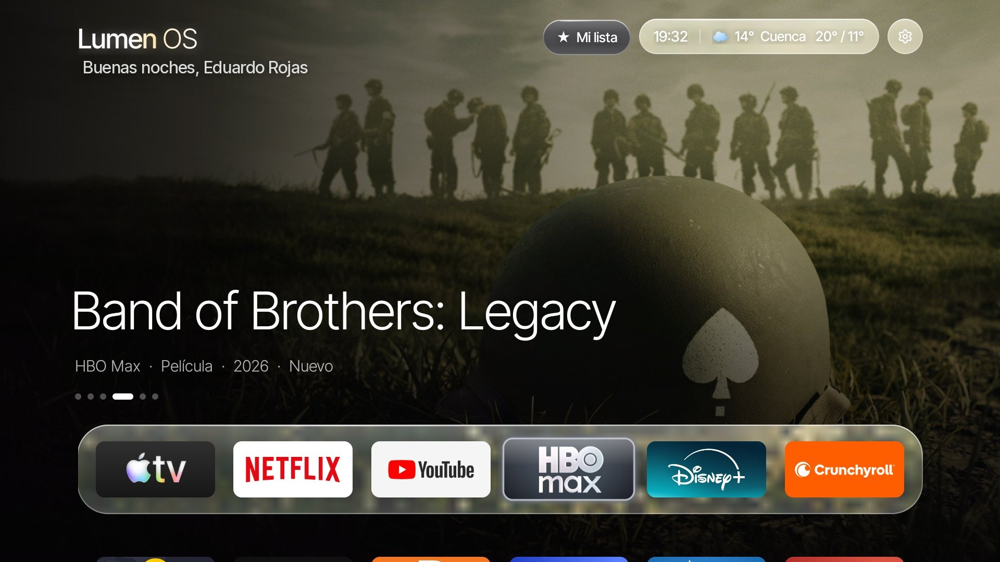 | 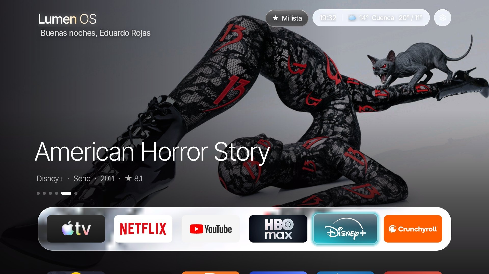 |
| **Crunchyroll** | **Todas tus apps** |
| 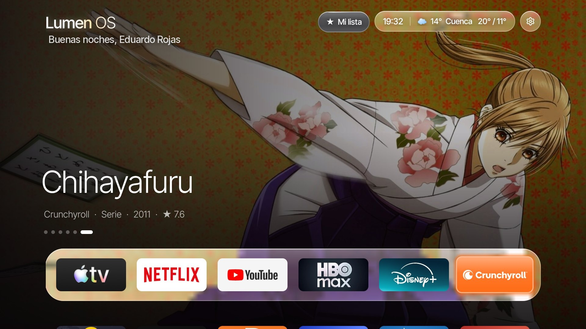 | 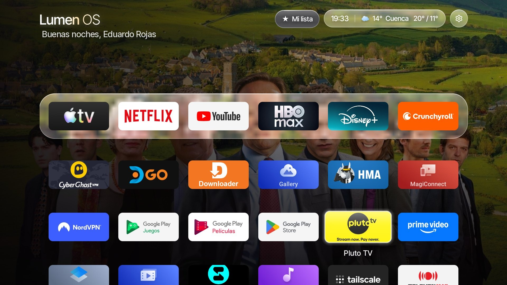 |
| **Ficha con tráiler** | **Mi lista** |
| 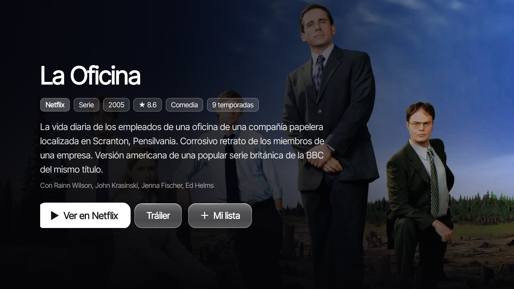 | 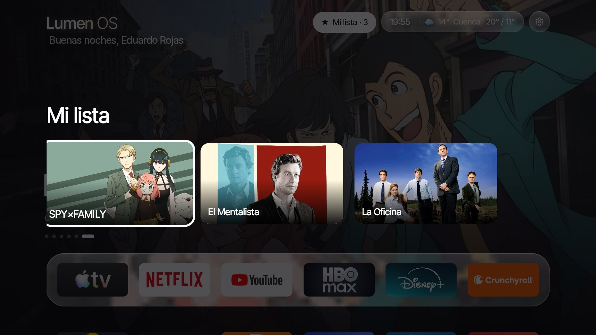 |
| **Clima hora por hora** | **Salvapantallas** |
| 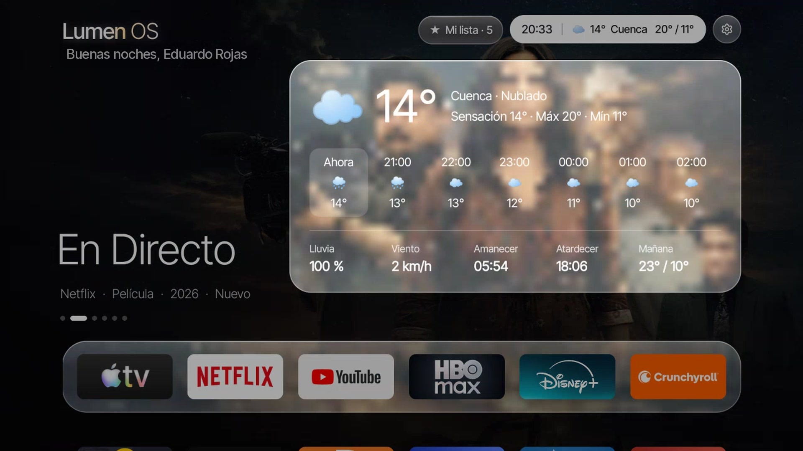 | 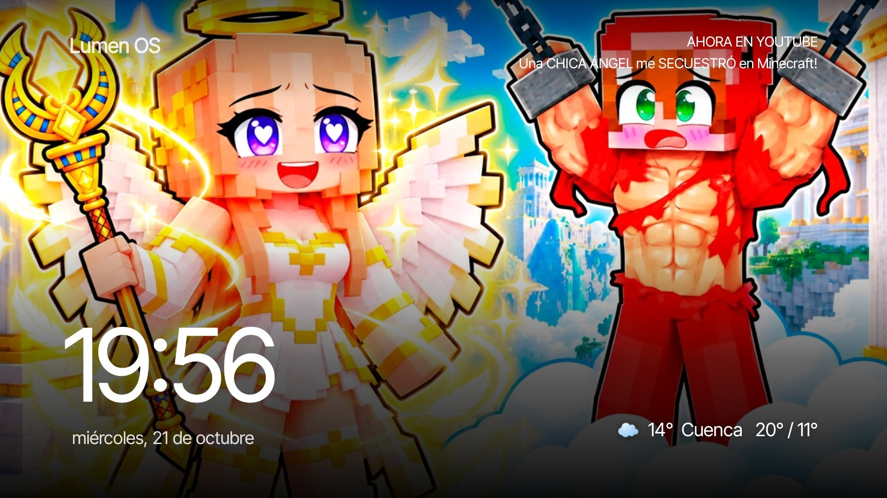 |

## Instalación rápida

¿Prefieres verlo? Sigue el **[video de instalación en YouTube](https://youtu.be/p3jJC1I-lsw)** (2:33).

1. **En el TV**: activa *Opciones de desarrollador* y *Depuración USB* (pasos en la guía).
2. **En la computadora**, descarga **[lumen-os.zip](https://github.com/eduardorv7-cmd/lumen-os/releases/latest/download/lumen-os.zip)** (última versión), descomprímelo y sigue tu guía:
   - Windows: [docs/GUIA-WINDOWS.md](docs/GUIA-WINDOWS.md) → `COMPILAR.bat` y luego `INSTALAR.bat`
   - macOS: [docs/GUIA-MAC.md](docs/GUIA-MAC.md) → `mac/compilar.sh` y luego `mac/instalar.sh`
3. **Opcional**: `COMPILAR.bat` te pide tus claves gratuitas de TMDB y YouTube (no se ven al escribirlas; Enter para omitir). Ver abajo para qué sirve cada una.

### Claves gratuitas

`COMPILAR.bat` te pide las dos (se escriben ocultas). **Si no tienes una, solo presiona Enter.**

| Clave | Para qué sirve | Sin ella |
|---|---|---|
| **TMDB** (necesaria para las recomendaciones) | Las películas y series a pantalla completa de Netflix, Disney+, HBO Max, Apple TV, Prime Video, Crunchyroll y demás; la ficha con sinopsis, reparto y tráiler; **Mi lista**; las imágenes del salvapantallas. | Esas apps muestran solo un fondo con su color; no hay ficha ni Mi lista. |
| **YouTube** (opcional) | Los videos en tendencia de tu país sobre el icono de YouTube. | YouTube se ve como una app normal, con su color. |

**Cómo sacar la clave de TMDB (gratis):**
1. Crea una cuenta en [themoviedb.org/signup](https://www.themoviedb.org/signup) y confirma tu correo.
2. Entra a [themoviedb.org/settings/api](https://www.themoviedb.org/settings/api) → **Solicitar una clave de API** → tipo **Desarrollador**, uso personal.
3. Copia la **Clave de la API** (32 letras y números).

**Cómo sacar la clave de YouTube (gratis):**
1. Entra a [console.cloud.google.com](https://console.cloud.google.com/) con tu cuenta de Google y crea un proyecto (por ejemplo "Lumen OS").
2. Abre [YouTube Data API v3](https://console.cloud.google.com/apis/library/youtube.googleapis.com) → **Habilitar**.
3. Ve a **Credenciales** → **Crear credenciales** → **Clave de API** y cópiala (empieza por `AIza`).
4. Recomendado: en la clave, **Restricciones de API** → solo *YouTube Data API v3*. No cobra: Lumen OS usa unas 8 de las 10.000 unidades gratis al día.

Todo lo demás (dock, vidrio, clima, saludo, arranque, botones del control) funciona sin claves. Tus claves quedan solo en tu computadora: `lumen.properties` no se sube a git. **No compartas el APK compilado**, porque lleva tus claves dentro.

Para volver a Google TV: `DESHACER.bat` (Windows) o `mac/deshacer.sh` (Mac).

## Funciona con

Android TV y Google TV con Android 9 o más nuevo (TCL, Hisense, Philips, Sony, Xiaomi, Chromecast con Google TV, etc.). Probado en un **TCL G07 (Google TV, Android 11, 2 GB)**. No funciona en Samsung (Tizen), LG (webOS), Roku ni Fire TV OS 8+.

## Qué cambia en tu TV

- Instala la app **Lumen OS** (`com.gathin.tvhome`) y la deja como Inicio.
- **Desactiva** (no desinstala) el Inicio de Google TV y, si hace falta, el asistente de configuración inicial. Antes de hacerlo comprueba que este último no sea el dueño de tu red Wi‑Fi guardada; si lo es, no lo toca y revierte.
- Activa un pequeño servicio de accesibilidad que solo lee los botones Netflix, YouTube y engranaje del control.
- Si al final el Inicio no quedó en Lumen OS, todo se revierte solo.
- La limpieza (`LIMPIEZA.bat`) es aparte y opcional: desactiva solo la lista de `tv-profiles/`.

Nunca toca TV en vivo, entradas HDMI, el teclado, Play Store, Play Services ni ajustes.

## Estructura

```text
launcher/      código del launcher (Android, Java)
  lumen.properties.example   tus claves y ciudad -> copia como lumen.properties (no se sube a git)
windows/       COMPILAR, INSTALAR, LIMPIEZA, DESHACER, MONITOR, YOUTUBE (.bat + .ps1)
mac/           compilar.sh, instalar.sh, limpieza.sh, deshacer.sh
tv-profiles/   listas de limpieza probadas por modelo
docs/          guías, capturas, video y la vista previa de la animación
tools/video/   proyecto de Remotion con el que se montó el video de demostración
```

## Créditos y licencias

Autor: **Eduardo Rojas** ([@eduardorv7-cmd](https://github.com/eduardorv7-cmd)).

Incluye partes de código abierto con licencia MIT; sus avisos de licencia están en [THIRD-PARTY-NOTICES.txt](THIRD-PARTY-NOTICES.txt). Detalle en [CREDITS.md](CREDITS.md).

Este producto usa la API de TMDB pero no está avalado ni certificado por TMDB. Datos del clima por [Open‑Meteo](https://open-meteo.com/) (CC BY 4.0). No está afiliado a Google, TCL, Apple, Netflix ni ningún servicio; los nombres y logos de las apps pertenecen a sus dueños.
